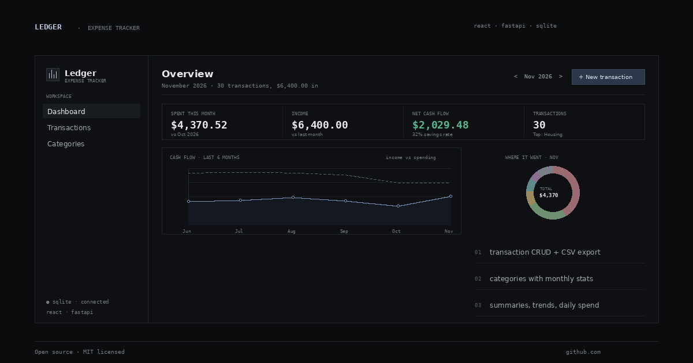
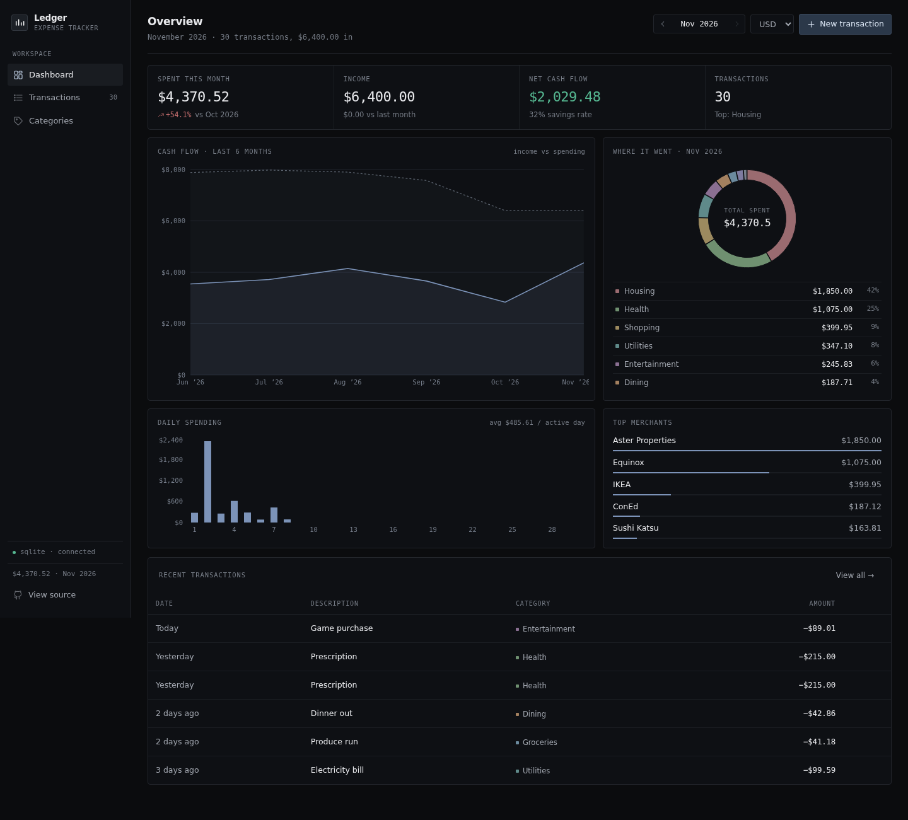
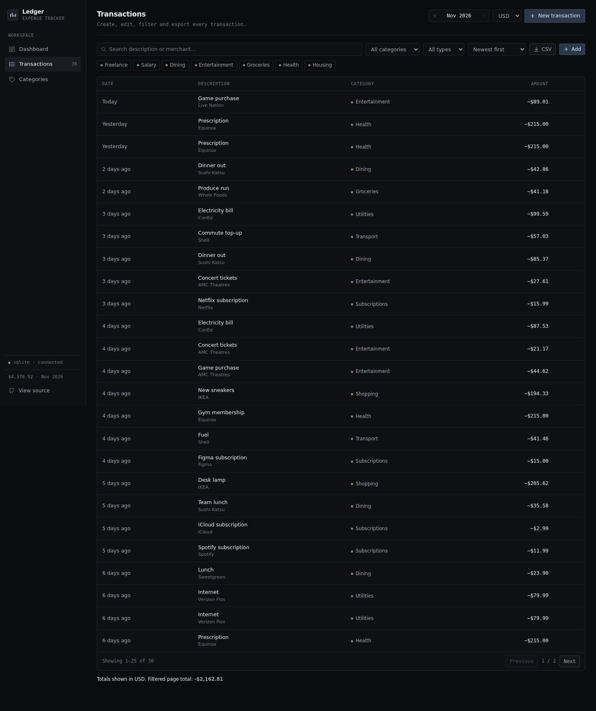
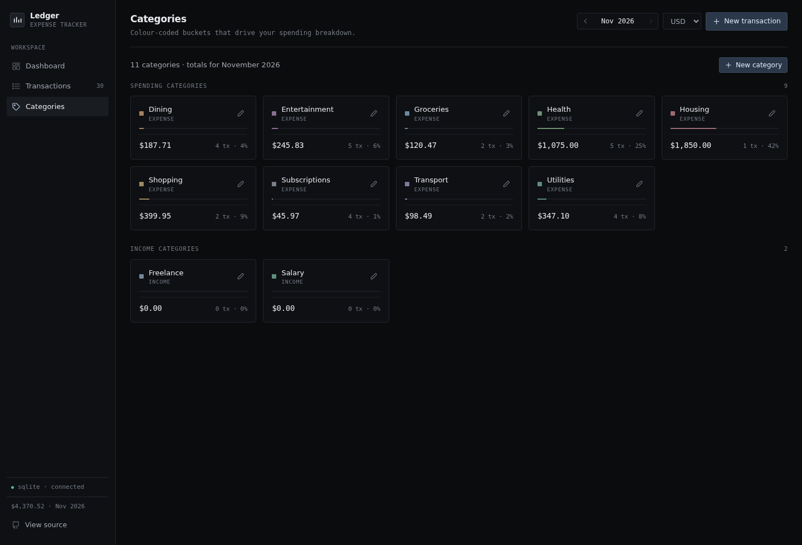
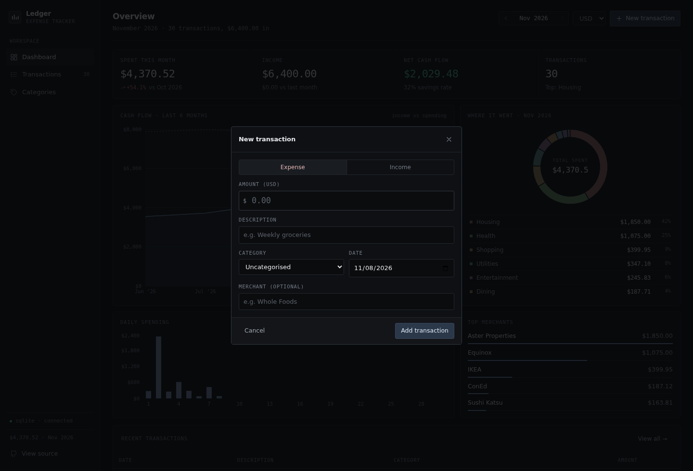
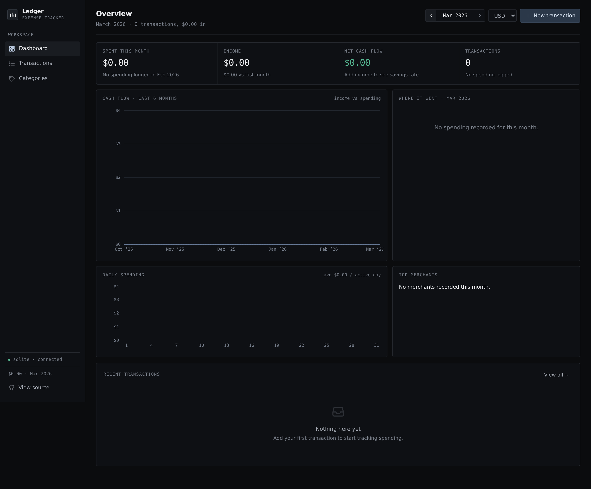
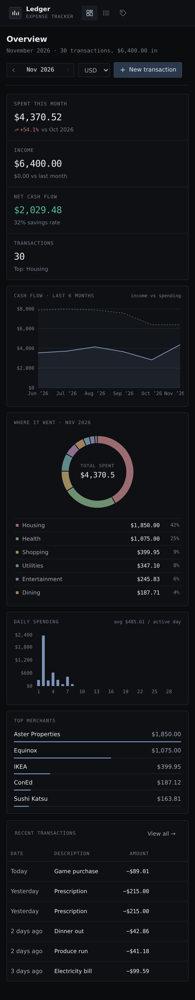

<div align="center">



# Ledger · Expense Tracker

**Add transactions, categorise spending, and read your month at a glance.**

A full-stack expense tracker — React + Vite front end, FastAPI + SQLite back end, charts driven by real SQL aggregates.

[](https://github.com/Mimatthews/expense-tracker/actions/workflows/ci.yml)
[](LICENSE)
[](https://www.python.org/)
[](https://nodejs.org/)

[Live project page](https://Mimatthews.github.io/expense-tracker/) · [Screenshots](#screenshots) · [Quickstart](#quickstart) · [API](#api-reference)

</div>



---

## Why this exists

Most budget apps ask you to trust a black box. Ledger is deliberately small: one
React app, one FastAPI service, one SQLite file. Every number on the dashboard is a
SQL aggregate you can read in `backend/app/routers/summary.py`, and every total is
stored as an **integer number of cents** so currency math never drifts.

## Features

**Transactions (full CRUD)**
- Create, edit and delete expenses and income with amount, category, date, description and merchant
- Search across description and merchant, filter by category and type, sort by date or amount
- Pagination, plus one-click **CSV export** of the current filtered view
- Server-side validation — amounts must be positive, descriptions non-blank, categories must exist

**Categories (full CRUD)**
- 11 seeded categories with colours, split into expense and income kinds
- Create your own, rename, recolour, delete
- Deleting a category **keeps its transactions** and marks them uncategorised (`ON DELETE SET NULL`) — no silent data loss

**Monthly summaries & charts**
- Spend, income, net cash flow and savings rate for any month, with month-over-month deltas
- Six-month cash-flow trend (area chart)
- Interactive category donut — click a slice to drill into those transactions
- Daily spending bars with average per active day
- Top-merchants ranking for the month

**Deliberately unglamorous UI**
- One accent blue, one border weight, 3–4px radii. No gradients, no glow, no glass,
  no icon-in-every-card-grid. Colour is functional: it separates categories, it doesn't decorate.
- Numbers are monospace and tabular everywhere, so figures line up down a column
- The four headline figures sit in one ruled band, not four floating cards

**The boring good stuff**
- Amounts stored as integer cents; SQLite in WAL mode with indexes on date, category and type
- Display currency switch (USD, EUR, GBP, GHS, NGN, CAD, INR) — storage is currency-agnostic
- Keyboard-friendly modals (`Esc` to close, autofocused amount), toast feedback, confirm dialogs
- Dark instrument-panel UI with no component library — hand-written CSS, one hairline border
  weight, one accent colour, monospace figures, responsive to 380px
- 8 backend tests with an isolated temp database per test, run in CI on every push

## Screenshots

| Transactions | Categories |
| --- | --- |
|  |  |

| New transaction | Empty month state |
| --- | --- |
|  |  |

<p align="center">
  
  <br />
  <em>Responsive down to a phone.</em>
</p>

## Stack

| Layer | Choice | Notes |
| --- | --- | --- |
| Frontend | React 18 + Vite 6 | Recharts for charts, hand-written CSS (no UI kit) |
| Backend | FastAPI + Pydantic v2 | Typed schemas, automatic OpenAPI docs at `/docs` |
| Database | SQLite | Single file, WAL mode, integer cents, foreign keys on |
| Tests / CI | pytest + GitHub Actions | Temp DB per test, frontend build check |

## Quickstart

Requires **Python 3.10+** and **Node 18+**. No Docker, no accounts, no API keys.

**1 · Backend** (terminal 1)

```bash
cd backend
python3 -m venv .venv && source .venv/bin/activate   # Windows: .venv\Scripts\activate
pip install -r requirements.txt
python -m app.seed                                   # optional: 6 months of demo data
uvicorn app.main:app --reload                        # http://localhost:8000
```

Interactive API docs: <http://localhost:8000/docs>

**2 · Frontend** (terminal 2)

```bash
cd frontend
npm install
npm run dev                                          # http://localhost:5173
```

The Vite dev server proxies `/api/*` to `127.0.0.1:8000`, so the browser only ever
talks to one origin — no CORS surprises in development.

### Useful flags

```bash
python -m app.seed --reset      # wipe transactions and reseed demo data
DEMO_MODE=1 uvicorn app.main:app --reload   # reseed on startup if the DB is empty
DATABASE_PATH=/tmp/my.db uvicorn app.main:app  # point at a different database file
```

### Run the tests

```bash
cd backend
pytest -q
```

```
........                                        [100%]
8 passed
```

The suite covers CRUD happy paths, validation rejections, filtering/pagination,
category-delete semantics, and the exact arithmetic of the monthly summary
(totals, shares, month-over-month change, full 30-day series).

## Project structure

```
expense-tracker/
├── backend/
│   ├── app/
│   │   ├── main.py              # FastAPI app, CORS, lifespan, /api/health
│   │   ├── db.py                # schema, connections, month helpers
│   │   ├── schemas.py           # Pydantic models + validation
│   │   ├── seed.py              # demo data generator
│   │   └── routers/
│   │       ├── transactions.py  # CRUD + search/sort/pagination
│   │       ├── categories.py    # CRUD + monthly usage stats
│   │       └── summary.py       # aggregation endpoints for the charts
│   ├── tests/test_api.py
│   └── requirements.txt
├── frontend/
│   └── src/
│       ├── App.jsx              # shell, routing, state, toasts
│       ├── components/          # Dashboard, views, charts, modals, icons
│       ├── lib/api.js           # typed-ish API client
│       ├── lib/format.js        # money/date formatting, cents helpers
│       └── styles.css           # design tokens + all component styles
├── docs/                        # GitHub Pages landing page + screenshots
└── .github/workflows/ci.yml
```

## API reference

Base URL `http://localhost:8000`. All request and response bodies are JSON.

| Method | Endpoint | Description |
| --- | --- | --- |
| `GET` | `/api/transactions` | List transactions. Query: `month` (`YYYY-MM`), `category_id` (`0` = uncategorised), `type`, `search`, `start`, `end`, `sort` (`date_desc`, `date_asc`, `amount_desc`, `amount_asc`), `limit`, `offset` |
| `POST` | `/api/transactions` | Create. Body: `amount_cents`, `type`, `description`, `occurred_on`, optional `category_id`, `merchant` |
| `GET` | `/api/transactions/{id}` | Fetch one |
| `PATCH` | `/api/transactions/{id}` | Partial update |
| `DELETE` | `/api/transactions/{id}` | Delete (`204`) |
| `GET` | `/api/categories` | List categories with `transaction_count` and `month_total_cents` |
| `POST` | `/api/categories` | Create (`409` on duplicate name) |
| `PATCH` | `/api/categories/{id}` | Rename / recolour / change kind |
| `DELETE` | `/api/categories/{id}` | Delete; transactions survive as uncategorised |
| `GET` | `/api/summary` | Monthly totals, category split, daily series, trailing trend. Query: `month`, `trend_months` |
| `GET` | `/api/health` | Liveness + active database path |

<details>
<summary><strong>Example: create a transaction</strong></summary>

```bash
curl -X POST http://localhost:8000/api/transactions \
  -H 'Content-Type: application/json' \
  -d '{
    "amount_cents": 1250,
    "type": "expense",
    "description": "Flat white",
    "merchant": "Blue Bottle",
    "category_id": 2,
    "occurred_on": "2026-11-07"
  }'
```

```json
{
  "id": 186,
  "amount_cents": 1250,
  "type": "expense",
  "category_id": 2,
  "category_name": "Dining",
  "category_color": "#f97316",
  "description": "Flat white",
  "merchant": "Blue Bottle",
  "occurred_on": "2026-11-07",
  "created_at": "2026-11-07 09:14:22",
  "updated_at": "2026-11-07 09:14:22"
}
```

</details>

## Design notes

- **Money as integers.** `amount_cents` is an `INTEGER` with a `CHECK (amount_cents > 0)`
  constraint. Formatting to `$12.50` happens at the edge, in `frontend/src/lib/format.js`.
- **Aggregates live in SQL.** The daily series uses `GROUP BY occurred_on` on the server,
  then fills missing days so the chart never has gaps. The browser only renders.
- **Deletes are honest.** `transactions.category_id` is `ON DELETE SET NULL` with
  `PRAGMA foreign_keys = ON`, so removing a category can never orphan or destroy rows.
- **Time is stored as a date, not a timestamp.** An expense belongs to a day, so
  `occurred_on TEXT` (`YYYY-MM-DD`) compares and groups lexicographically and stays
  timezone-proof.
- **One connection per request,** WAL mode for concurrent reads. For a personal
  tracker this is more than enough; swap in MySQL/Postgres by changing `db.py`.
- **Colour is muted on purpose.** Category hues are low-chroma (`#6b8a9e`, `#a3805f`, …)
  so six slices in a chart stay distinguishable without becoming confetti, and the
  accent blue still reads as *the* accent.

## Deploy the landing page (GitHub Pages)

The `docs/` folder is a self-contained static landing page (no build step, no external
assets), which is what GitHub Pages serves.

1. Push this repo to GitHub.
2. **Settings → Pages → Build and deployment**
   - *Source*: **Deploy from a branch**
   - *Branch*: `main` · *Folder*: `/docs`
3. Save. Your page appears at <https://Mimatthews.github.io/expense-tracker/>.

> **Note:** GitHub Pages only serves static files, so the app itself (FastAPI + SQLite)
> runs locally or on any Python host — e.g. Render, Railway or Fly.io for the API plus
> Vercel/Netlify for the built frontend. The Pages site is the portfolio entry point.

## Roadmap

- [ ] Budgets per category with progress bars and overspend warnings
- [ ] Recurring transaction templates
- [ ] Multi-user auth (JWT) and per-user data isolation
- [ ] Postgres adapter + Alembic migrations
- [ ] Import transactions from bank CSV

## License

[MIT](LICENSE) — use it, fork it, ship it.

<div align="center">
  <sub>Built as a first portfolio project. Feedback and pull requests are welcome.</sub>
</div>
